# LiquidityLab: Go runtime and Python RL migration

Decision plan updated 23 October 2026 against commit `7a0488d`. The Go core, replay bridge, public-data pipeline, PostgreSQL store, durable paper actor, Python inference worker, Go policy client, authenticated API, and paper CLI/server are committed. The React interface is present but uncommitted. This update plans the remaining integration and scale work; the stages below are acceptance requirements, not claims of production readiness or measured capacity.

## Decision in brief

Use Go for the product runtime, financial state, venue connections, and replay engine; retain Python for Gymnasium, training, evaluation, and initially inference. Use React/TypeScript for the trader interface. Start with a modular service, PostgreSQL, and a separately supervised policy worker, then partition execution by account as measured demand grows.

Go is the engineering choice for this boundary. It is not yet demonstrated to be the fastest complete training path: checked-in benchmarks show the current Go/gRPC bridge below Python reference throughput. Runtime account capacity and operational recovery remain unmeasured. Optimize each workload against its own evidence.

The next delivery is a complete durable **paper execution assistant**: create a bounded trade, preview baseline execution, start, observe partial fills, pause/cancel, restart safely, and inspect the execution journal. Ship that workflow with a Go baseline before requiring an RL policy. RL remains the same Go engine behind a Python Gymnasium interface, and a proposal source in the product.

## Implementation order at a glance

1. Freeze shared contracts and prove Go accounting/replay conformance against Python.
2. Connect Python Gymnasium to batched Go replay; retain Python training and inference.
3. Deliver a durable paper assistant with PostgreSQL, account ownership, and bounded queues.
4. Add the trader interface, evaluated policy proposals, and private venue recovery.
5. Demonstrate recovery and bounded capacity before a supervised live pilot; increase admission and add account shards only after further measured validation.

The first usable product is a trader-supervised execution assistant. It accepts a trader's intended trade and helps execute within its quantity, price, and time limits. RL is one replaceable proposal source; the product can operate with its Go baseline while policy evaluation continues.

## 1. Decision and scope

Make **Go the authoritative product and execution runtime**, with **Python owning the RL interface, training, evaluation, and initially model inference**. Keep the trader interface in TypeScript/React.

Go is the selected engineering direction for the persistent service, concurrent venue connections, account ownership, recovery, and deployment. Whether it is the best-performing implementation at the intended scale must be established by measurement. Network behavior, database durability, exchange limits, allocation rates, and model inference can dominate language-level differences.

This decision supersedes the earlier plan's Python/FastAPI product backend, SQLite production ledger, and proposed NautilusTrader execution-engine dependency. Existing Python code remains the reference implementation during migration. No private exchange integration or production database exists to migrate today.

The first release continues to support crypto spot, one venue, and one active parent order per connected account. The architecture supports many accounts without permitting concurrent writers to any one account. More instruments and accounts come before multiple venues or several simultaneous plans against one balance.

The product remains an execution assistant: a trader chooses the trade and its size, price boundary, and deadline. A policy proposes execution actions. The Go runtime checks and carries them out.

## 2. Current implementation and what moves

The original starting point was Python v0.1.0 with 40 checks. The repository has since advanced; use the following checkpoint when scheduling remaining work:

- **Committed:** versioned/generated Go and Python protocol bindings; exact amounts; shared ledger/compiler, fees, reservations, observations, passive matching and baselines; deterministic replay/conformance; public recorder and incremental normalizer; bounded replay RPC and Python Gym/vector/PPO bridge; PostgreSQL ownership, inbox, journal and outbox; durable paper actor/scheduler/transport; recorded-data CLI; authenticated API; bounded paper server; Python inference worker and Go policy client.
- **Present but uncommitted:** React supervision interface in `apps/web/` and `docs/trader-ui.md`. Review and demonstrate the complete browser workflow before its release commit.
- **Remaining:** asynchronous model integration with actor fallback; full session history/replay; process-kill recovery evidence; scalable shared feed distribution; immutable evaluation/promotion; private venue integration; CI/deployment and measured operational capacity. Current journal reads expose metadata, and the HTTP interface polls; full historical reports and SSE are not implemented.
- **Measured constraint:** the optimized replay bridge delivers about 23k transitions/second at batch 32 versus about 37–46k for Python in the checked-in synthetic comparison. Keep Python as the default training backend until the bridge gate passes. See [benchmark evidence](../benchmarks/README.md).
- **External gates:** real public capture has failed on this host; private-account access, an authorized live pilot, and design-user evidence are still outstanding.

The existing code and checks establish implementation progress, not execution quality or account capacity at scale.

The responsibility mapping for the rewrite is:

- `contracts.py`: instrument rules, precise amounts, plan constraints, action meanings, and validation.
- `accounting.py`: balance changes, fees, fill idempotency, remaining quantity, and cost accounting.
- `compiler.py`: policy-action conversion into bounded child-order intents.
- `book.py`: book validity and simulated consumption debt.
- `replay.py`: event ordering, simulated fills, order arrival/cancellation/settlement, features, and execution metrics.
- `data/kraken.py`: public stream decoding, checksum validation, capture, gap handling, and normalization.
- `policies.py`: scheduled and liquidity-aware baseline execution behavior.

Keep in Python:

- `env.py`: Gymnasium API, action and observation spaces; its eventual backend calls Go.
- `training.py`: PPO/SB3 integration, invalid-trajectory guard, and policy bundles.
- Model loading/inference, evaluation tooling, analysis, and experiment configuration.
- The present Python replay implementation as a temporary conformance reference.

Keep the current Python CLI working through the migration. Complete the Go product CLI/server separately. Remove reference execution code from the default training path only after Go conformance and bridge performance pass. Existing training artifacts are unvalidated and must not be silently promoted to a different engine.

## 3. Target architecture



Start with a **modular Go service**, a **Python policy worker**, and **PostgreSQL**. An offline Go replay worker is a separate mode of the same execution code. Serve the built browser interface from the Go service. Split deployments later when measured workloads require independent scaling.

Go owns:

- Trader API and authenticated commands.
- Plan revisions, account reservations, and durable execution history.
- Canonical market state and feature construction.
- Hard boundaries, action compilation, and child-order state.
- Venue credentials, order transport, reconciliation, and stop/pause behavior.
- The deterministic core used by both replay and live operation.

Python owns:

- Gymnasium wrapping and vectorized training orchestration.
- Policy optimization, evaluation, and bundle publication.
- Inference on a versioned feature vector; it returns a semantic action.

The inference worker receives neither exchange credentials nor a direct order-submission capability. A model response is a proposal. Go validates it against current account state and recompiles it against the current book before creating any order intent.

PostgreSQL is the durable source for application state. The exchange remains authoritative for actual acceptance, fills, and balances. A database record cannot make an unknown exchange outcome known.

## 4. Shared contracts first

Create versioned Protocol Buffer schemas under `proto/liquiditylab/v1/` and generate Go/Python bindings. Use them for inference and the offline replay bridge. Keep the browser API as versioned HTTP JSON with a documented mapping to the domain contracts. Protobuf supports generated contracts and has specific evolution rules; reserve removed field numbers and do not reuse enum meanings. [Protocol Buffers guide](https://protobuf.dev/programming-guides/proto3/)

Core contracts include:

- Instrument identity and immutable metadata revision.
- Exact decimal amount, currency, price, quantity, fee rate, and fee amount.
- Plan ID/revision, account ID, hard boundaries, start, deadline, and fallback choice.
- Market event, receipt-session identity, local receipt index, and source validity.
- Observation schema, ordered feature names, and preprocessing fingerprint.
- Decision request/response, semantic action, and decision expiry.
- Child intent, command ID, venue ID, execution identity, and reconciliation outcome.
- Episode specification, step result, settlement status, and economic-score validity.

### Amounts and arithmetic

Never transport money as binary floating point. Use a canonical decimal representation with a signed integer coefficient encoded as a string and an explicit scale. Currency is mandatory for monetary amounts. Validate digit/scale limits before allocating or calculating.

The initial Go decimal type should wrap checked, exact arithmetic using private `math/big` state, with immutable value semantics and explicit rounding operations. Preserve raw source strings separately for venue checksum calculation. Profile this representation before substituting narrower integer fast paths.

Define and test operations for addition, multiplication, comparison, floor/ceil to a tick/lot, and conservative fee reservation. Specify division rounding and the supported precision envelope rather than inheriting a language's default context. Use higher internal precision for products; reject unsupported amounts instead of wrapping, clipping money, or silently rounding through float64. PostgreSQL numeric columns must use the same approved bounds.

Python's default Decimal precision is not the financial specification. The conformance harness must use sufficient explicit precision. If an extreme-value fixture exposes an existing Python rounding defect, correct and version the specification rather than reproducing a known defect in Go.

### Time and action versions

Use integer nanoseconds for relative replay time. Store live absolute deadlines in UTC and use a local monotonic clock for waiting while the process is alive. A monotonic timestamp is not transferable across restarts or hosts. Clock discontinuities trigger revalidation before new execution.

Legacy float-second tapes need an explicit import rule: parse the written decimal representation, quantize to nanoseconds with a documented rule, and preserve receipt order. Characterize differences caused by old float arithmetic at ties. Introduce `LiquidityLab-SpotExecution-v1` for the Go-backed environment rather than declaring this migration invisible to existing bundles.

The wire enum reserves zero for `UNSPECIFIED`; assign explicit values to HOLD, CANCEL_CHILD, PASSIVE_SMALL, PASSIVE_NORMAL, AGGRESSIVE_SMALL, and AGGRESSIVE_NORMAL. The current Python action integers are 0–5, so generated bindings require an explicit mapping. Unknown values are rejected. Cancelling a child does not cancel the parent obligation.

## 5. One execution core for replay and production

Implement a deterministic Go reducer that accepts explicit market, account, control, and timer events and produces state changes plus effects. It must not read wall time, perform network I/O, or access a database internally. Supply clocks, persistence, and venue adapters at the runtime boundary.

Use the same amount logic, plan rules, compiler, reservation accounting, feature builder, and baseline policies in live and replay modes. Fill sources differ: replay uses a model, while live uses confirmed venue events. Identical code does not imply identical market outcomes.

Preserve these current semantics through explicit conformance cases:

- Receipt events win equal-time ties before simulated arrival, then cancellation.
- A cancellation request retains reservations and can race with a fill.
- Replacements wait for the prior child to become known-final.
- A passive quote touch alone does not imply a fill.
- Simulated liquidity debt survives unchanged book updates and decision intervals.
- A feed gap invalidates an active replay episode.
- Settlement freezes the residual price reference at the decision cutoff.
- Known partial completion has a valid terminal cost; unknown settlement does not.
- Once settlement is complete, later unrelated tape gaps do not invalidate that result.
- Terminal cost and incomplete-quantity penalty are applied once.

Before making Go the default, compare both implementations on the same approved vectors. Monetary balances, fees, quantities, order outcomes, and cost components must match exactly. Boolean/schema/action meanings must match exactly. Define float32 feature tolerance in ULPs and a reward tolerance in the contract; start with two float32 ULPs for derived features and investigate discrepancies rather than widening tolerances automatically.

Record intended time-format or arithmetic corrections as v1 behavior changes. Re-evaluate policies trained against v0 after those changes.

## 6. Python Gym interface to Go

Run a local Go replay process for each training job, managing a bounded set of independent simulated environments. Python's Gym wrapper owns opaque environment handles and calls the replay process through a loopback or Unix-socket gRPC connection.

Proposed offline methods:

- `CreateBatch`: load a dataset manifest once, create N isolated environments, and return handles plus engine/schema versions.
- `ResetBatch`: select validated episode specifications and seeds, return observations and reset metadata.
- `StepBatch`: submit one semantic action per handle and return observations, rewards, termination/truncation, and score validity.
- `GetReports`: retrieve final detailed reports outside the hot training step.
- `CloseBatch`: release handles and mapped dataset resources.

Batch across parallel environments. Do not make one cross-language RPC for every market tick, and do not resubmit an entire recording with every step. The Go process advances the tape internally to the next decision or settlement boundary. One environment's state must never share liquidity debt, balances, random state, or order IDs with another.

A replay RPC must carry a request sequence and stable operation identity. A timed-out step may already have advanced the environment, so the server caches the last result or exposes status by request identity; a client cannot blindly retry and advance the same episode twice. Limit environment count, payload size, outstanding work, and report size.

The current methods are unary RPCs. Enforce application-level admission, count/byte limits, and deadline checks explicitly; streaming transport flow control does not provide unary work admission. [gRPC flow control](https://grpc.io/docs/guides/flow-control/)

The Python training guard rejects invalid/unresolved outcomes before they enter PPO rollouts. Policy-independent invalid intervals are excluded identically before evaluation. Policy-dependent failures stay in failure statistics and block promotion.

Keep an explicit `backend="python-reference"` during transition. Make `backend="go"` the new v1 environment only after parity, isolation, cancellation, and throughput gates pass. Avoid cgo/CPython bindings initially; consider a native binding only if profiling shows batched local RPC remains a meaningful bottleneck.

## 7. Live inference boundary

A decision request includes tenant/account/session identity, session revision, account/order-state revision, observation schema/hash, policy bundle checksum, market snapshot identity, request ID, observation vector, and validity budget. The Python worker verifies compatibility before inference and echoes the binding metadata with its action.

Set explicit RPC deadlines; gRPC does not provide a useful application deadline automatically. Cancellation must also be handled in the server's work scheduling. [gRPC deadlines](https://grpc.io/docs/guides/deadlines/)

Go allows at most one outstanding inference request per active plan initially. It rejects a response if the plan/account/order state changed, the plan stopped, the bundle/schema differs, or the request expired.

Do **not** require that no newer market tick arrived. That would reject almost every response on an active book. Permit newer market data when the request remains within its freshness budget, then compile the semantic action against the latest valid book and current hard boundaries. Log both observation and execution snapshot identities. A model does not submit a stale raw price directly.

If inference misses its budget or the queue is full, apply the plan's preselected pause or Go baseline behavior. Operator cancellation, account events, and reconciliation do not wait for Python. Bound Python queues and CPU thread counts. Pin a policy bundle per active session; updates affect new sessions unless an explicit controlled switch is implemented later.

Use one Python worker initially. Later replicate inference workers by compatible bundle/model demand, with bounded batching that fits the live latency budget. Do not combine offline training and production inference in the same resource pool.

An ONNX deployment is a later optimization requiring export and action-parity checks. A small Python inference worker is the first implementation; the plan does not assume an official Go inference binding or a lossless export for every future model.

## 8. Durable runtime and account ownership

Use one serialized account actor per connected exchange account. It owns reservations for all currencies, known/unknown orders, and the account-state revision. Parent plans execute under that authority. Independent account actors may run concurrently in a bounded worker process.

API replicas validate access and append revision-checked, idempotent commands. They never submit orders directly. Account routing is derived from durable ownership, not whichever HTTP process received the request.

PostgreSQL stores plan revisions, command deduplication, intents, outbox entries, fills, reservations, account projections, ownership, policy eligibility, and reconciliation checkpoints. Apply the account transition, reservation, and outbox insert in one transaction. Use explicit row locking/constraints where required; PostgreSQL documents both row-level locks and advisory locks. [Locking reference](https://www.postgresql.org/docs/current/explicit-locking.html)

Do not write every public market tick into the transactional database. Record public streams in append-only chunks with manifests; build shared books in memory. Add object storage and analytical formats when measured retention/query requirements justify them.

The outbox dispatcher persists attempt state before transport. A crash after exchange acceptance but before local acknowledgement creates an unknown outcome, not permission to resend. Client IDs and local idempotency do not establish universal exactly-once exchange execution. Reconcile open orders and executions before resolving unknown intents.

An outbox intent is not permanent permission to trade. Immediately before outbound transport handoff, route order creation back through the account authority and revalidate ownership epoch, plan revision/status, deadline, reservations, instrument rules, and current market/account validity. Serialize that authorization with pause/cancel processing. Transactionally obsolete unsent intents when their plan stops, their revision changes, or validity expires. A request already handed to transport is treated as potentially in flight and must be cancelled/reconciled; a pause cannot retract bytes already sent. Record the dispatch authorization revision and snapshot identity.

### Account readiness and external activity

The initial live pilot requires an account under exclusive application management while an execution session is active. This is an explicit operating constraint, not a property conferred by an API key or account actor. It does not require a venue subaccount feature. Pre-existing external open orders block readiness; the application does not cancel someone else's orders to clear that condition. Broader support for concurrently managed/manual account activity is a later capability.

Before the first send and after reconnect, reconcile balances, open orders, recent executions, and local unknown intents using a venue-specific snapshot/stream handoff. Buffer and deduplicate private events against documented source identities/checkpoints and repeat queries where required. The integration milestone must demonstrate the handoff with concurrent events; do not assume REST queries form one atomic snapshot. If a consistent account state cannot be established, remain paused.

Track total/free/locked balances and which local reservations are already reflected in venue holds. Subtract unreflected pending local reservations from venue-free funds; do not subtract known venue holds twice. Recompute revisions and reservations after reconciliation. Unexpected manual trades, deposits/withdrawals, unknown orders, or balance differences invalidate readiness and pause affected execution until explained. If exclusive management cannot be observed for a pilot account, use paper mode until shared-account reservation support is implemented.

### Ownership and failover

Use durable ownership epochs and leases to reject stale database writes. The sender verifies current ownership before dispatch. However, **a database fencing token does not fence the exchange**: an old process may retain a live connection or already have a request in flight.

Initial failover is controlled: pause new sends, isolate/terminate the previous sender, reconcile its known and unknown intents, then enable the new owner. An expired lease alone is insufficient to authorize a second sender. If old-owner isolation cannot be established, stay paused and require operator recovery. Name the operator/supervisor responsible, record process/connection isolation evidence durably, and link it to the ownership-transfer decision; trusted recovery booleans alone do not demonstrate isolation. Exercise a suspended old owner that resumes after attempted transfer. Measure the maximum interval from a stop request to the last possible outbound handoff, including synchronous transport delays. Automated high availability requires a separately verified outbound-fencing design and venue capability analysis.

Within a healthy deployment, shard accounts deterministically across executor processes. Rebalance only through draining, ownership transfer, and reconciliation. Keep per-account venue message limits and any wider venue limits authoritative across all workers.

## 9. Market data, backpressure, and ordering

Maintain one shared public feed/book per venue/instrument per ingest shard, then distribute immutable snapshots or versioned references to interested account actors. Account-private events remain isolated by tenant and account.

Preserve exact wire values for Kraken checksums. Retain subscription-depth truncation, explicit deletions, historical trade-snapshot filtering, and resnapshot behavior from the Python recorder. A missed delta invalidates the book until reconstruction succeeds.

Use bounded queues and distinguish their semantics:

- Public book deltas: preserve required order; overflow invalidates/resnapshots the book.
- Account/fill events: stop new execution on a gap or overflow and reconcile from venue history; never silently drop accounting facts.
- Inference work: reject or expire excess requests rather than allowing stale backlog.
- UI snapshots: coalesce replaceable display state, while keeping a durable audit history.
- Recording: monitor write lag and disk capacity; stop presenting an incomplete recording as continuous valid history.

Avoid giving a goroutine to every public market message. Use long-lived bounded workers and serialized reducers where state order matters. Operator stop requests get prompt handling while preserving already observed account-event causality.

## 10. Product API and initial deployment

Use Go's HTTP server for the product API and WebSocket/SSE updates. Use explicit command IDs and expected revisions for plan creation, start, pause, resume, and cancel. Status updates distinguish requested cancellation, confirmed cancellation, and unresolved state.

The initial self-hosted deployment contains:

- One Go process running API, market ingest, account executor, and reconciliation modules.
- One separately supervised Python inference process.
- PostgreSQL with durable storage and tested backups.
- Static React assets served by Go.
- Offline replay/training processes launched separately from the live service.

Maintain explicit replay/paper/live profiles. Paper profiles cannot construct the live order transport or access production credentials. Browser sessions and Python workers never receive exchange secrets. Production remote access requires authenticated commands and transport, even before a hosted multi-user service exists.

Scale the API, ingest, execution, and inference deployments independently only as their measured bottlenecks emerge. A message broker, Kubernetes, and a distributed cache are optional later decisions. The first scale step is account partitioning and shared market data, not service proliferation.

## 11. Proposed repository layout

Keep existing Python paths working while adding:

```text
liquiditylab/
  go.mod / go.sum
  cmd/liquiditylabd/             # API/ingest/executor modes
  cmd/liquiditylab/              # Product and offline Go CLI
  internal/domain/              # Exact amounts, contracts, immutable values
  internal/execution/           # Reducer, compiler, reservations, baselines
  internal/execution/features.go # Shared versioned observation construction
  internal/replay/              # Simulation clock, fills, settlement
  internal/replayrpc/           # Bounded replay service and wire mapping
  internal/marketdata/           # Books, recording, fanout and validity
  internal/venue/kraken/         # Protocol parsing and authenticated transport
  internal/runtime/             # Account actors, ownership and recovery
  internal/store/postgres/       # Transactional state and outbox
  internal/inference/            # Python policy client and eligibility
  internal/api/                  # HTTP/operator commands and updates
  proto/liquiditylab/v1/         # Language-independent contracts
  gen/go/                       # Generated Go protocol types
  src/liquiditylab/              # Existing Python package, retained
    v1/                         # Generated Python protocol types
    go_backend.py               # Gym/vector environment adapter
    go_vector.py                # Batched SB3 adapter
    inference/                  # Python model worker
  apps/web/                     # Trader interface
  migrations/                   # Ordered PostgreSQL migrations
  conformance/                  # Versioned common input/output vectors
  benchmarks/                   # Workload manifests and measured results
  deploy/                       # Local compose and process configuration
```

Keep the Go release, Protobuf compiler/plugins, database driver, and RPC packages pinned. Generated code must be reproducible and checked for schema drift. Credentials and market recordings stay outside version control. Most runtime directories above now exist. `apps/web/` is present but uncommitted; production deployment packaging and any new shared ingest/account-routing modules remain planned. Inspect Git history before scheduling a component as new work.

## 12. Migration phases and gates

The estimates below describe the original full effort, not a new estimate of work remaining. Phases 1–4 and the persistence part of phase 5 already have substantial implementation. Complete the remaining exit criteria without rewriting those components again. Development load measurements begin alongside paper execution; the final production-capacity claim follows the complete adapter and workload validation.

### Phase 1 — specification and fixtures: 2–3 focused days

Current checkpoint: schemas, generated bindings, exact wire mapping and common fixtures are committed; finish the full contract/compatibility audit against the exit criteria.

Freeze v1 amount/time/action contracts, extract common golden cases from the existing tests, and add malformed/overflow/rounding/cancellation fixtures. Record all intentional differences from the Python implementation.

Exit: generated Go/Python messages, an executable schema-conformance harness, and a clear mapping from current policy/observation versions. The Python suite remains green.

### Phase 2 — Go domain core and replay: 4–6 days

Current checkpoint: the core, baselines, replay and four common economic/observation cases are committed; broader event-sequence/fuzz coverage and the full acceptance audit remain gates.

Implement exact amounts, ledger, compiler, order lifecycle, deterministic clock, book/depletion model, features, and settlement. Add scheduled and liquidity-aware baselines.

Exit: Go replays the approved tapes and matches the reference economics/state outcomes; new v1 time behavior is documented. Test generated event sequences, duplicate executions, and cancellation races. Go race tests cover runtime-facing mutable state.

### Phase 3 — Go public-data pipeline: 2–4 days

Current checkpoint: parser, recorder and normalizer are committed; obtaining and validating a real public recording remains outstanding.

Port raw decoding, CRC validation, capture manifests, normalization, and book validity. Run both normalizers against the same raw recordings. Do not replace a failed real capture with invented live data.

Exit: checksum/source precision cases match; corruption is detected; live capture is verified when network access permits. The previously observed handshake failure remains an integration issue until demonstrated otherwise.

### Phase 4 — Go-backed Gym bridge: 4–6 days

Current checkpoint: the bounded service, Gym/vector adapter and PPO roundtrip are implemented; the measured throughput/default-cutover gate has not passed.

Implement batch RPC and isolated environment handles, then wrap them in Python Gym/vector interfaces. Verify retry/step identities and training failure propagation.

Exit: PPO can train, save, load, and infer against the Go-backed v1 environment. A worker crash cannot silently continue a different episode or reuse an action. Measure batched transport overhead against the Python reference before defaulting to Go.

### Phase 5 — durable paper execution: 4–6 days

Current checkpoint: store, actor, paper transport, passive matching, baseline scheduling, recorded-data CLI, incremental public-feed integration and paper server are committed. Complete browser integration and process-kill/restart evidence; checkpoint-level recovery coverage does not establish operational failover.

Implement PostgreSQL migrations, account actor, reservation/outbox transactions, command deduplication, recovery, and current-market paper fills. Keep live transport unavailable in this profile.

Exit: restarting at each intent/ack/cancel boundary preserves the account and parent obligation; unknown outcomes remain reserved. Competing owners cannot make new application state authoritative. Test pause/cancel, deadline expiry, stale revisions, and invalid data against queued-but-unsent outbox orders: obsolete intents must not be newly handed to transport. Test a concurrent fill where transport already began as an in-flight reconciliation case.

### Phase 6 — Python inference service: 3–4 days

Current checkpoint: Python worker, Go client, strict bundle/request binding and a real Python PPO-to-Go proposal boundary are committed. Actor scheduling, asynchronous completion, deterministic fallback and promotion/eligibility integration remain outstanding.

Add bundle/schema verification, bounded worker scheduling, inference deadlines, response binding, and Go fallback/pause behavior.

Exit: stale, incompatible, delayed, duplicate, and malformed responses cannot produce an unauthorized order. Fast market updates do not cause perpetual rejection of otherwise valid semantic actions.

### Phase 7 — trader API and interface: 5–8 days

Current checkpoint: scoped authenticated API, exact preview and curated execution projections are committed. React interface is present but uncommitted; full history/session replay, workflow evidence and design-user validation remain outstanding.

Build the plan form, active execution screen, pause/cancel, history, and session replay. Expose actual versus simulated results clearly. Add command authentication for remote deployment.

Exit: design users can supervise a paper session and understand partial completion and pending cancellation without reading model internals.

### Phase 8 — live adapter and controlled recovery: 4–8 days

Integrate account/private streams, submission, cancellation/expiry, fee reconciliation, and venue budgets. Exercise failure boundaries with a simulator before an explicitly authorized bounded live pilot.

Exit: exchange-confirmed fills reconcile; restart/failover procedures and the private snapshot/stream handoff are demonstrated; no ambiguity is resolved by a blind retry. Pre-existing external orders block pilot readiness, unexpected external activity pauses execution, and free/locked/local-reserved balances do not double-count holds. Exercise deadline/pause races with the real adapter's outbound queue as well as the mock transport. Live credentials and pilot authorization are external dependencies.

### Phase 9 — workload and operational validation: 3–5 days, partly parallel

Measure ingress, actor delay, DB commit latency, inference, queue bounds, memory/GC, and replay throughput. Repeat fault cases under load. Include a soak test and database restore drill.

Exit: publish the hardware/workload manifest, measured bottlenecks, and the capacity actually supported. Reduce claimed limits when targets fail rather than weakening correctness.

The original full-scope estimate was roughly 31–50 engineering days for an experienced builder, or **8–12 weeks for the migration and narrow supervised beta** with integration buffer. It is not a new remaining-work estimate: substantial components now exist, while runtime integration, usability and external venue gates still carry uncertainty. Re-estimate the remaining delivery after the paper actor and policy-client reviews. A hosted multi-user service or broad multi-venue product requires another scope and estimate.

## 13. Scale targets and benchmark method

Replay benchmarks and allocation profiles have been recorded; no product account-capacity benchmark or full operational soak has passed. The following are initial engineering test targets, not supported production claims. Replay transitions/second, normalized feed events/second, actor commands/second, venue submissions/second, and active accounts are separate quantities.

Use a pinned reference host with 8 vCPUs and 16 GiB RAM for Go, PostgreSQL, and CPU inference, with the exact CPU, storage, OS, process limits, and model recorded. Use a mock venue for load and fault injection; do not generate load through real trading endpoints.

Initial workload:

- 50,000 normalized public market events/second across ten instrument books.
- 100 connected mock accounts, each with one active parent and a one-second policy cadence.
- 500 private/account events/second in aggregate, including duplicates and recovery bursts.
- A separately bounded UI subscriber load; start at 100 connected screens.
- Venue limits enforced by the mock adapter; logical policy rate is not a promise of order submissions per second.

Proposed service objectives under that workload:

- p99 receipt-to-applied-public-book delay below 25 ms with bounded memory.
- p99 ready-observation-to-durable-decision-intent below 150 ms, including inference; explicit inference expiry within 200 ms.
- p99 local acknowledgement of a pause/cancel command below 100 ms. Exchange cancellation completion is measured separately.
- No silent account-event loss, lost reservations, duplicate execution accounting, or automatic resolution of unknown orders.
- Go RSS below 4 GiB and bounded queue occupancy during a 24-hour soak on the reference workload; record whole-host resource headroom too.
- Replay at least matches Python reference throughput on identical hardware and semantics. Batched bridge overhead should consume at most 10% of training wall time for the defined reference vector workload.

Measure baseline Python throughput before claiming a Go speedup. Report p50/p95/p99, throughput, allocation rate, GC CPU, max queue age, DB latency, and error counts together. Use profiles to identify bottlenecks. Go's GC has CPU/memory tradeoffs; tune it from observed workload behavior, not an assumption that Go eliminates pauses. [GC guide](https://go.dev/doc/gc-guide) · [Profiling guide](https://go.dev/blog/pprof)

Use a provisional 100 ms inference allocation inside the 150 ms decision target, leaving 50 ms for feature preparation, validation and persistence. The 200 ms validity budget is a hard stale-response cutoff, not a second latency target or permission to queue work for 200 ms. Measure the end-to-end percentile directly; summing individual component p99 values does not establish an end-to-end p99.

Then test 250 and 1,000 accounts to discover the first limiting component. An unmet target is a measured limit, not a reason to send stale actions or relax account ownership. Tune or add a shard only after identifying whether the constraint is the DB, account actor, model workers, memory, or venue budget.

### Staged deployment and the reason to split each component

**Stage A — supervised beta.** Deploy one Go service, PostgreSQL, and a separate Python inference process. Keep public books shared by instrument, account mutation serialized, and training/replay on separate resources. Set a supported account limit from the measured workload. Admission refuses new sessions when the service cannot preserve its latency, recovery, or venue-budget headroom.

**Stage B — partition account execution.** Add executor processes when account work breaches the latency objective or sustained CPU/queue pressure leaves insufficient failover headroom after profiling and tuning. Persist an explicit account-to-owner assignment and ownership epoch. A routing hash may suggest assignments; changing worker count must not silently change ownership. Drain an account, settle or classify outstanding sends, isolate the old sender, reconcile, and then activate the new owner. A single hot account remains serialized and may need a lower supported workload.

**Stage C — isolate shared ingest and inference.** Extract ingest if parsing, fanout, recording, or GC materially interferes with account latency. Fan out versioned snapshots with receipt-session identity, snapshot revision, and book validity. Receivers detect loss/restart and stop price-sensitive actions until resynchronized. Replicate Python inference when measured queue age consumes its deadline budget; route by bundle compatibility and reject excess work. Preserve end-to-end expiry after retries and load balancing.

**Stage D — scale storage and history.** Separate large public recordings and historical analytics from transactional account state. Use manifest-addressed object storage for immutable recording chunks. Add database capacity or partitioning only when measured commit latency, lock waits, storage I/O, or recovery time requires it. If account storage is eventually sharded, colocate each account's commands, fills, reservations, intents, and outbox in one transactional shard. Design identity/uniqueness scope explicitly before migration. Read replicas may serve delayed history; execution decisions use authoritative state.

**Stage E — independent API capacity.** Scale authenticated HTTP/UI delivery separately if subscriber or read traffic consumes execution resources. Commands remain revision-checked durable inputs routed to the account owner. Bound subscriptions and coalesce UI snapshots. A history query or slow browser must not block private-event processing.

Stage order after B follows the observed bottleneck. Adding a broker, orchestrator, or service boundary is a separate decision with an owner, failure model, and measured benefit. These are LiquidityLab design choices, not language guarantees.

### Capacity model and database write budget

Use measured service demand to choose admission, rather than deriving capacity from goroutine counts. For A active accounts, cadence D seconds, E durable private/paper facts per account per second, and K durable transitions per decision, estimate decision demand as A/D and DB transition demand as A × (E + K/D), then include command, lease, recovery and retry overhead. Measure E and K from traces; paper passive matching can make E track trade rate even when no fill occurs.

Publish serialized state bytes/transition, journal growth, WAL bytes/second, commit latency and lock waits alongside throughput. Current snapshots include book/state and accumulated fills; bound their growth and measure the cost of rewriting them. Before increasing admission, consider incremental fill/history tables and less frequent bounded checkpoints while retaining atomic balances, reservations, deduplication and outbox transitions. Verify replay from each checkpoint and migration compatibility. Batch ordered source receipts only if every fact remains recoverable and a crash cannot apply a fill twice. Do not replace durable financial facts with coalesced UI state.

A model worker's single-flight client is a concurrency bound, not a 100-decisions/second guarantee. If measured safe worker service time is S seconds, provision from utilization × worker_count / S, with margin below saturation and a measured burst budget. Stagger periodic decisions; a synchronized burst of 100 accounts can overload a worker even if its average rate appears sufficient. Keep latency targets unchanged when scaling worker count.

Acceptance: compare 100 accounts on shared instruments with staggered and synchronized decisions, no-fill trade bursts, one hot account, slow DB, inference loss and private-event recovery bursts. Report total DB connection caps across processes, fairness, oldest event age and rejected admission. Require recovery and control headroom under the advertised limit. Exact numeric capacity remains unknown until those runs pass.

### Resource budgets and operational measurements

Publish a capacity manifest for each release: maximum active accounts, instruments, environments, connections, queue counts/bytes/age, DB connections, inference concurrency, tape memory, disk retention, and in-flight venue requests. Initial values are configuration subject to benchmark acceptance. Limit both item counts and bytes: one oversized event/report must not bypass a queue's memory budget.

Admission checks must reserve headroom for recovery bursts and cancellations. Put a deadline and cancellation path on external work and database calls; do not hold an account database transaction open during Python inference or venue network I/O. Read an observation snapshot, perform inference outside the transaction, then revalidate revisions within the durable transition. Bound concurrent DB access across actors instead of allocating one permanent connection per account.

Apply per-account command, mailbox, subscription, and inference quotas as well as process totals. One active parent per account remains the initial limit. Schedule bounded work fairly across runnable actors, with dedicated capacity for control and recovery. A hot account cannot monopolize the worker pool. Private-event overflow invalidates that account's readiness and starts reconciliation; admission pressure rejects new starts before existing accounts lose their operating headroom.

Avoid multiplying feed volume by account count. Apply each public delta once per instrument book. Account decisions consume versioned snapshots at their configured cadence. Deliver ordered trade/order-relevant events only to affected paper actors; those events cannot be replaced by occasional snapshots when simulating passive fills. At 100 accounts and one decision/second, the initial model workload is roughly 100 decisions/second, independently of the 50,000-event/second ingest target. A single Python worker must demonstrate that demand or admission must be lower.

Measure service demand per account and instrument before choosing shard sizes: CPU milliseconds per second, resident bytes, DB transactions/second, journal bytes/day, and inference time/decision. Record fixed ingest cost separately. Budget aggregate database connections across every process; the existing store's bounded pool is per store instance and does not establish a deployment-wide cap. Add a shared concurrency budget or proxy when multiplying instances. Preserve measured headroom for a recovery burst and the loss/draining of a worker before admitting more sessions.

Separate order-create, cancel, account-recovery, and REST-history budgets according to venue rules. Preserve capacity for cancellation and reconciliation during submission pressure. Backoff with jitter on throttling and apply account/global limits at their documented scope. More Go workers or API keys do not imply more venue trading capacity. Kraken documents separate REST counters and trading-engine limits across protocols. [Kraken rate limits](https://docs.kraken.com/exchange/guides/rest/ratelimits)

Instrument public-book lag, oldest private event, actor mailbox age, durable command age, outbox unknown count/age, ownership changes, reservation discrepancies, inference expiry, venue throttle counts, and recording write lag. Keep account/tenant IDs in authorized logs/traces rather than unbounded metric labels. Record p99 latency together with rejection, pause, truncation, and disconnect rates so load shedding cannot conceal overload.

Set retention and deletion rules for raw recordings, execution audit history, reports, and backups before hosted deployment. Recordings and bundles carry checksums and schema/engine revisions. Disk-pressure handling must preserve durable account writes and mark incomplete captures. Define and measure backup recovery point and recovery time objectives before making an availability commitment.

Provisional paper-beta retention: keep seven days of hot raw public capture and thirty days total; immutable datasets referenced by bundles or evaluation evidence are pinned and exempt from expiry. Keep thirty days of diagnostic logs with sensitive fields redacted. Preserve account journals, fills, reservations, commands, and policy provenance for the entire beta; their eventual retention and deletion policy is a separate hosted-release decision. Prune complete chunks only after verifying manifests and active references. Estimate bytes/day from measured wire volume and compression before selecting storage capacity.

Provisional disaster-recovery objectives are at most five minutes of database recovery-point loss and sixty minutes to restore a paused service on the reference deployment. Use base backups plus continuous WAL archiving, monitor archive lag, and verify access to encrypted backups and recovery keys. PostgreSQL documents the base-backup/WAL recovery mechanism and its archive-continuity requirements. [PostgreSQL continuous archiving](https://www.postgresql.org/docs/current/continuous-archiving.html) Drill restoration into an isolated database, verify journal/projection consistency, then reconcile against venue history before enabling execution. Track time to reconciled readiness separately; the sixty-minute target does not promise trading resumes while exchange outcomes remain unknown. These are proposed acceptance targets until a restore drill demonstrates them.

### Capacity promotion and rollback criteria

Use a mock venue and paper accounts for cohorts of 1, 10, 25, and 100 active accounts. Hold each for at least thirty minutes with the defined ingress, private-event bursts, inference delays, and UI traffic; hold the final supported workload for the full 24-hour soak. Capture the manifest and percentile/error/resource measurements for every cohort.

Promote only when the latency/resource objectives above pass, queues drain after the injected burst, no unexplained reservation/accounting differences remain, and fault-induced unknown intents resolve within the scenario's specified recovery budget. Each scenario declares that budget before running. A growing unknown/recovery backlog, persistent queue growth, or any accounting/ownership violation stops the ramp. Return admission to the last demonstrated capacity and investigate; do not force ownership transfer or discard queued accounting facts to reduce the displayed load. Production admission limits come from the last passed workload, with documented recovery headroom.

## 14. Verification and release requirements

Retain the current 40 checks as a reference and expand them with cross-language and runtime checks:

- Exact amount parsing, tick/lot rounding, fee currencies, overflow bounds, and duplicate fill identity.
- Golden full and partial execution reports and independent reward reconciliation.
- Receipt/arrival/cancel ties, persistent liquidity debt, invalid data, and settlement finality.
- Go/Python schema compatibility, explicit enum mapping, feature order and numeric tolerance.
- Replay environment isolation, timed-out step retries, seed determinism, and reset identity.
- Stale inference, policy mismatch, late replies after cancel, and fallback under load.
- Transaction rollback, outbox acceptance ambiguity, account ownership loss, and failover isolation.
- Pause/deadline races with queued outbox orders, account-readiness handoff, external activity, and venue-hold reservation reconciliation.
- Market queue overflow, resnapshot, private-stream recovery, rate limits, and disk exhaustion.
- API authorization, tenant/account isolation, log redaction, and restore/reconciliation.

Use Go fuzzing for parsers, amounts, and event sequences, and the race detector for concurrency checks. These tools find different classes of defect; neither proves exchange correctness. [Go fuzzing](https://go.dev/doc/security/fuzz/)

Run conformance and isolated mock-venue tests in CI. Real-money checks remain an explicitly authorized operational stage. Policies need the existing holdout/promotion process in addition to runtime correctness; an engine port does not validate a trading policy.

## 15. Commit and orchestration plan

Keep each part in a separate reviewable commit, continuing the user's existing preference:

1. Versioned schemas and conformance fixtures.
2. Go module, exact amounts, and domain invariants.
3. Go execution reducer/compiler and accounting parity.
4. Go replay, fills, features, and settlement parity.
5. Go public recorder and normalization parity.
6. Batched replay service and Python Gym adapter.
7. PostgreSQL migrations, account ownership, reservations, and outbox.
8. Python inference worker and Go policy client.
9. Trader API and authenticated command handling.
10. Trader interface and execution journal.
11. Private venue integration and recovery.
12. Load/fault benchmarks, deployment, and runbooks.

Commit boundaries may split further when a part is large; each commit must identify its own verification evidence and remaining limitations. Preserve the current working Python package until the replacement path passes its gates.

Use GPT-6.1-sol for integration decisions, ownership/recovery review, arithmetic semantics, and cross-language parity. Use cheaper subagents for bounded generated-schema wiring, fixtures, straightforward tests, documentation, and UI forms once contracts are frozen. Assign disjoint files and reconcile through the integration lead. Do not delegate independent incompatible designs for the financial core.

## 16. Implementation checkpoint and next milestone

Use [implementation-progress.md](implementation-progress.md) as the requirement ledger and [benchmark evidence](../benchmarks/README.md) for the measured training constraint. Preserve the committed core, bridge, store and paper runtime; integrate the remaining product/model/operations work incrementally. The existing Python trainer stays runnable throughout.

### Remaining delivery sequence

The following are the next reviewable changes, in dependency order. Commit each numbered part separately; split adapter and operations work further as needed. Existing committed modules are retained.

1. **Complete the baseline paper desk.** Review the existing React code and prove preview → create paused → start → partial fills → pause/resume → cancel, including unknown command outcomes, account switching, stale feed and token scope. Add complete session reports/history and causal replay links in a separate follow-up commit; journal metadata is insufficient for this view. Show exact fees, quantities, arrival benchmark and simulated provenance. Exit: a trader can finish and inspect a session without reading runtime logs.
2. **Separate revisions and instrument the durable path.** Specify command/financial revision, plan revision, market snapshot version and source cursor separately. Audit where no-fill paper trades currently advance the persisted account revision. A current market tick alone must not perpetually invalidate previews or policy responses; fills, holds, readiness and controls still invalidate financial authority. Keep durable deduplication/source ordering when reducing writes. Add transaction, snapshot-byte, WAL and lock-wait measurements before changing persistence. Exit: high-rate no-fill input does not starve valid commands, while any intervening financial/control change rejects obsolete actions.
3. **Connect asynchronous policy proposals.** Reuse the committed worker and Go client. The actor captures a bound observation, releases its processing slot, and receives a completion event later; it never waits for Python or holds a DB transaction during inference. Allow one outstanding proposal per plan, with a process-wide admission budget. Pin bundle/schema and log observation/execution book identities. Revalidate under the actor before compiling against the latest book. Stagger account cadence, reject excess work and apply the plan's explicit baseline or pause fallback once per decision slot. Exit: delayed/crashed/saturated workers cannot delay cancellation or create a second action after fallback.
4. **Prove restart and ownership recovery.** Build an OS process-kill harness around intent persistence, attempted send, acknowledgement, fill, pending cancel and observation reduction. Reopen the same account; demonstrate reservations and unknown outcomes survive. Transfer ownership only after old-sender isolation and reconciliation. Exit: one authoritative sender and accounting projection through each injected boundary, with unresolved outcomes remaining paused/reserved.
5. **Add shared ingest and measured multi-account operation.** Apply public deltas once per instrument; distribute replaceable versioned book views separately from ordered trade events needed for passive paper matching. Bound count/bytes/age, freeze source watermarks for finite drains, and reserve control/recovery capacity. Build a mock venue and load generator. Exit: the section 13 workload has measured end-to-end latency and bounded queues; publish rejected work and paused accounts with latency results. A missed ordered event invalidates the affected consumer rather than silently skipping it.
6. **Package evaluation and operations.** Separate commits for immutable chronological datasets/evaluation reports, promotion records, generated-code/build CI, profile-specific process packaging, metrics and operator runbooks. Use baseline comparisons, multiple seeds, fill/fee assumptions and complete failure counts. Exit: reproducible bundle provenance, restore into a paused service, and a reviewed release manifest. A mutable bundle flag never grants live eligibility.
7. **Implement the private venue boundary.** Separate commits for authenticated transport, private stream/snapshot handoff, reconciliation and rate budgets. Exercise unknown acceptance, duplicate fills, cancel/fill races and external activity with the mock venue first. Obtain real public-capture evidence; it remains an open integration gate. Exit: documented account readiness and fault handling with real venue evidence before the separately authorized bounded live pilot.
8. **Set supported capacity, then shard.** Complete load-plus-fault runs, 24-hour soak and backup/restore drill on pinned hardware. Publish the supported limit from measured bottlenecks and recovery headroom. Add explicit durable account assignments and controlled transfer only when one executor reaches its limit; repeat the same gates after partitioning. Retire reference execution paths only after the cutover gates below pass.

Parts 1–4 establish the useful, recoverable paper product. Revision semantics precede model integration. Measurement tooling can proceed in parallel against frozen interfaces; private transport can be developed against a mock while deployment/evaluation proceeds. Live access, public network capture, pilot approval and design-user evidence are external gates, not assumptions in the schedule.

### Remaining-work estimate and orchestration

Planning allowance for one experienced implementer using reviewed subagents: **3–5 weeks for parts 1–4**, including history and process-boundary recovery; **another 3–6 weeks for parts 5–8 and a narrow operational beta**, with evaluation/tooling partly parallel. These are provisional engineering ranges, not a promise of venue approval or policy profitability. Re-estimate after the paper workflow and persistence profiles expose integration cost. They replace neither the historical full-migration estimate in section 12 nor explicit external gates.

The integration lead owns financial semantics, revision design, async scheduling, ownership and release decisions. Use GPT-6.1-sol for that work when available; cheaper subagents can own disjoint UI components, documentation, fixtures and bounded harnesses against approved contracts. Integration review remains required. Each commit records its scope, evidence and open gates; planning changes do not imply implementation checks were rerun.

### Training performance workstream

Keep this separate from the paper-product critical path. Profile batching, serialization, allocation, per-environment sequential work and model/rollout overhead using representative tapes and actions, not only HOLD. Compare the same environment count, semantics, episode lengths and hardware. Include cold start/upload, steady stepping, resets, terminal reports, memory and full PPO wall time.

Improve the bounded RPC implementation first. Consider packed observation buffers, parallel advancement of independent environments, and a native extension only when profiles identify their benefit; preserve exact financial arithmetic and ordered state within an environment. Keep the service boundary if it meets the complete workload objective. Any new transport must retain retry identity, environment isolation, bounds and crash behavior. Default cutover requires exact economic conformance, approved feature tolerance, no regression in invalid-trajectory handling, and the throughput/training-overhead gates in section 13.

### Cutover, rollback, and removal of the reference path

1. **Offline comparison:** feed immutable tapes and commands to both engines and compare economic results. Both may simulate. Preserve intentional v1 time/precision changes in versioned fixtures.
2. **Paper comparison:** run the Go assistant on public data with mocked venue effects. An optional Python comparison observes copied inputs only. Persist all real product commands through the Go account authority.
3. **Shadow on an authorized live account:** any comparison process observes and reports; exactly one runtime has order transport. An advisory model or reference engine cannot submit a second copy of the trade.
4. **Controlled cutover:** pause admission and new sends, drain/reconcile outstanding intents, take a checkpoint, and establish the new owner. Resume only with a known account state and compatible schema/bundle. Expose the active engine/version in the execution journal.
5. **Rollback:** halt new sends and isolate the outgoing sender before transfer. Restore compatible application state and reconcile with the venue. Rolling back a binary or database snapshot does not reverse venue fills. Use expand/migrate/contract database changes: add compatible structures, backfill/checkpoint resumably, deploy readers/writers that support both versions, and remove old structures only after the rollback window. Pin session engine/policy/schema compatibility and block downgrades that cannot read current state. Failed migrations leave execution paused; resume from their checkpoint or apply a forward repair before considering a disaster restore.
6. **Reference retirement:** remove Python monetary/execution code from supported product/training paths only after conformance, bridge throughput, paper recovery, policy reevaluation, and a documented rollback window pass. Retain versioned fixtures and artifact provenance for old reports.

Maintain three independent release decisions: **product admission** (paper/live account limits and operational recovery), **Go training default** (conformance and full training performance), and **live authorization** (venue readiness, eligible policy/baseline and explicit pilot approval). Each record names immutable evidence, approved limits, decision owner and rollback procedure. Each rollout stage needs its own evidence; a fast replay does not establish safe live recovery or account capacity.

## 17. Evidence boundaries

The module mapping is based on the current repository. The architectural choices, timelines, numeric targets, and deployment topology are proposed decisions. Documentation links support specific platform capabilities, not a claim that LiquidityLab already implements them. Current behavior and known limits remain recorded in [verification.md](verification.md) and [simulation.md](simulation.md).
