# LiquidityLab: implementation plan

Prepared 23 October 2026. Planning baseline. Implementation has begun in [the LiquidityLab project](../README.md); its README records current capabilities and remaining work. No private exchange execution has been enabled.

## 1. Product decision

Build an execution assistant for discretionary crypto spot traders, powered by a reusable RL execution environment. A trader chooses the asset, direction, quantity, price boundary, and deadline. The assistant places and manages the child orders needed to carry out that instruction.

The first RL task is **bounded execution of a trader-defined order**. Its observations describe current market and order state. Its actions change execution pace and aggressiveness. Its reward measures execution cost and incomplete quantity. Historical replay supplies training episodes; live operation runs a frozen policy.

The user-facing promise is: **“Set your trade boundaries, supervise execution, and see what every fill cost.”** Execution savings remain a hypothesis until measured. The product is useful through order management, fill tracking, and an execution journal before an RL policy is promoted.

Confirmed choices:

- Market: crypto spot.
- Primary user: discretionary traders using an execution assistant.
- The RL environment remains a core deliverable.
- The project must support an actual trading workflow.

Recommended implementation assumptions:

- First venue: Kraken Spot, subject to the builder and initial users having appropriate account/API access. No account access has been checked.
- Initial instrument: BTC/USD; add ETH/USD after the complete workflow works. Resolve availability and instrument rules from the exchange at startup.
- Initial order: base-asset quantity, either buy or sell, with a hard limit price and a deadline.
- First release: one user, one connected account, one active parent order at a time, self-hosted on an always-on machine.
- Execution sessions last minutes, with an initial one-second policy decision interval. Exchange and order events are processed continuously between decisions.
- Desktop browser interface; local Python backend; CPU inference. GPU training is optional.

These assumptions narrow implementation without committing the user to a venue, hosting provider, purchase, or live trade.

## 2. How the idea improves across iterations

### Iteration A: generic trading Gym

Original idea: train an agent on historical data, then run it against current markets. This leaves the trading task, user, and source of usefulness too broad. Buy/sell/hold actions alone do not define a deployable product.

### Iteration B: a reusable execution environment

Improvement: define one task with clear inputs and boundaries. “Buy this quantity under this price by this deadline” produces a tractable environment and an understandable result. It also gives traders control over their existing trade ideas.

### Iteration C: an assistant discretionary traders can operate

Improvement: make trade setup, supervision, pause/cancel, partial fills, and the execution journal the main interface. Python policy integration becomes an extension, rather than something every user must learn.

### Iteration D: replay the trader's own executions

Improvement: record the observed market, policy decisions, orders, and real fills for each session. Replay the session with alternative execution policies to estimate differences, explicitly identifying simulated fills. Compare actual outcomes with the simulator's predictions to find modeling errors.

This creates a practical feedback loop: execute, inspect, calibrate, then evaluate the next policy. Counterfactual savings remain estimates; a historical replay cannot establish what a different real order would have caused.

### Iteration E: promote policies only where they are useful

Improvement: retain a dependable rules-based execution mode. A learned policy becomes available only for supported instruments, order sizes, fee settings, and market conditions. A change in data quality or account state can pause the session regardless of policy output.

The plan implements B and C first, includes D in the initial beta, and introduces E before live policy execution. More autonomous trading decisions belong to a later product decision.

## 3. Who benefits and how to validate the need

Initial users should already trade crypto spot and regularly split entries or exits into multiple orders. Suitable needs include avoiding repeated manual repricing, keeping an order within a price boundary, and understanding fees and fill quality.

Recruit three to five design users before building the full interface. Ask them to walk through their last three relevant orders and identify the work they repeated manually. Record their venue, trade frequency, typical order size relative to visible liquidity, and existing execution tools. These are proposed discovery activities, not completed interviews.

Continue with this execution focus if at least three users can identify a recurring task and want to supervise a paper session. If their orders are tiny relative to available liquidity and their current order types already meet the need, investigate a better user segment before investing in adaptive execution.

Broker/exchange tools already cover many execution algorithms. The proposed differentiation is the combination of trader-defined boundaries, a clear execution history, and session replay with inspectable fill assumptions. Demand for that combination must be established with users.

## 4. Scope of the first usable release

Include:

- One spot venue and one initial pair.
- Setup and preview of an order plan.
- A transparent scheduled execution policy and a simple liquidity-aware policy.
- Historical replay, live-data paper execution, and a separate live runtime.
- One RL algorithm and versioned policy artifacts.
- A single screen for active execution and another for execution history/replay.
- Durable order tracking, account reservations, recovery, and data-health checks.
- Fees, average fill price, completion, execution cost, and incomplete quantity.

Defer:

- Leverage, derivatives, short sales, and automatic selection of assets or trade direction.
- Multiple venues, smart routing, arbitrage, and simultaneous parent orders.
- Hosted custody of user exchange credentials or a public multi-user SaaS.
- News analysis, chatbots, strategy marketplaces, and online policy exploration with live funds.
- Native mobile apps, automatic stop/target strategy management, and institutional block execution.

One venue, one account, and one active parent order are meaningful architectural constraints for this release. Expanding them requires account-wide reservation and execution-concurrency design.

## 5. Trader workflow

### Connect and inspect

The user configures an exchange connection on the backend. The browser receives connection health, balances, instrument rules, and fee configuration. Paper and live modes have distinct backend configuration and visible labels. A live session requires a separate explicit start action.

### Create a plan

Required inputs:

- Instrument and buy/sell direction.
- Gross executed base quantity, with estimated net received quantity shown separately.
- Maximum buy price or minimum sell price.
- Start time and deadline.
- Execution style: scheduled, liquidity-aware, or an eligible learned policy.
- Maximum child-order size and total quote budget for buys, including a fee reserve.

The preview shows current spread, visible liquidity, estimated fee range, and whether the chosen quantity/deadline can plausibly complete. These are estimates with timestamps. Reject an invalid instrument, insufficient funds, inverted times, or quantities below venue minimums before activation.

For a hypothetical price-independent example: “Buy 0.05 BTC over 15 minutes, never submit a buy above my limit, and cancel unfilled quantity at the deadline.” The trader supplies the actual price limit.

### Start and supervise

The user sees filled and remaining quantity, average fill price, fees, active child order, deadline, policy mode, and connectivity. Display concrete events such as “Limit order partially filled” or “Waiting for cancellation confirmation.” Explanations come from observed state and compiler/guard decisions; do not invent a model's private reasoning.

### Pause, resume, cancel

Pause stops new submissions and requests cancellation of the app's active child order. The interface stays in “Pausing” until order state is known. A fill can arrive while cancellation is in flight. Resume is available only after reconciliation and before the original deadline.

Cancel ends the parent plan after owned child orders have reached known final states. It does not sell previously purchased assets or reverse completed fills. The UI reports unresolved exchange state rather than declaring an unknown order cancelled.

### Deadline and completion

The hard price boundary takes priority over completion. At the deadline, stop new submissions and cancel remaining owned orders. Report partial completion where appropriate. Cancellation is asynchronous, so the final report can include fills confirmed while the plan was stopping.

Use exchange expiration for resting orders where supported and verified. An application timer alone cannot guarantee a disconnected order will expire at the intended time.

## 6. Architecture and reuse decision



The core boundaries are:

1. **Contracts and execution logic:** instrument rules, order-plan state, reservations, observations, policy actions, and accounting.
2. **Replay engine:** historical data, simulation clock, execution/fill models, and deterministic event ordering.
3. **Gymnasium wrapper:** turns replay into reset/step episodes for training.
4. **Live runtime:** asynchronous market/account events, policy timers, an order compiler, guards, durable submission, and exchange reconciliation.
5. **Application layer:** API, operator controls, reports, and browser interface.

Replay and live share semantic contracts and decision logic. They use different clocks, fill sources, and runtime loops. The same policy can consume both observation streams, but identical interfaces do not imply identical fills or returns.

Prefer an existing execution engine for market adapters, order events, and account state. NautilusTrader documents shared strategy code across backtests and live operation, and a Kraken integration. This makes it a strong candidate for the engine underneath our own environment and assistant. [Strategy model](https://nautilustrader.io/docs/latest/concepts/strategies/) · [Kraken integration](https://nautilustrader.io/docs/latest/integrations/kraken/)

A three-day feasibility milestone must verify the selected released version, not assume that every feature in moving documentation is installed. Prove controlled stepping, private-state integration through fixtures/read-only access, and durable app recovery. Wrap engine types at the boundary so policy and app code remain independent of its implementation.

If the integration fails that milestone, write a short decision record comparing a version pin/change with a narrow direct connector. Do not silently implement an entire exchange engine while keeping the original estimate. This is an explicit schedule gate.

### Suggested stack

- Python: execution contracts, environment, runtime coordination, training, and reporting.
- Gymnasium: replay environment interface.
- PyTorch and Stable-Baselines3 PPO: first trainable policy. Lock compatible released versions during feasibility work.
- NautilusTrader: preferred underlying execution/backtest integration, subject to the gate above.
- FastAPI and WebSocket streaming: local control API and screen updates.
- React and TypeScript: trader interface.
- SQLite with transactions: single-user durable app ledger and outbox; one writer owns order/account transitions.
- Parquet plus DuckDB: recorded market events, episode manifests, and offline analysis.
- Local filesystem: versioned policy bundles, reports, and recording manifests. Add object storage only when needed.
- Docker Compose: application and runtime packaging on an always-on host. Heavy training runs in a separate process.

Start without Kafka, Kubernetes, a distributed task queue, or a separate model-serving service. The execution process must continue independently of the browser and API request lifetime.

## 7. Data acquisition and quality

Start recording immediately during the first implementation milestone. A live snapshot API is not a historical depth archive. Use recorded public order-book updates and trades; buy historical depth only if a specific data gap justifies it.

Kraken's documented L2 feed supplies aggregated price levels, snapshots, updates, and checksums. Preserve raw values before transforming them, and validate book reconstruction using the venue's documented rules. [L2 feed](https://docs-legacy.kraken.com/api/docs/websocket-v2/book/)

Each normalized market event records:

- Venue, symbol, event type, source/session ID, and local event index.
- Exchange timestamp, local receipt timestamp, and monotonic receipt order.
- Raw-message reference and schema version.
- Price/quantity changes or trade details.
- Source sequence/checksum when provided; never manufacture an exchange sequence number.
- Validity and recovery markers.

Keep exchange timestamps for market accounting and receipt order for causal replay. Do not reorder a recorded late-arriving message into the past and thereby give a simulated agent information earlier than a live agent received it.

On disconnect or checksum mismatch, invalidate the book, stop decision eligibility, and reconstruct from a new confirmed snapshot. Record the gap. Do not create training episodes that cross invalid data silently.

For L2 plus trade streams, define their relative event ordering and prevent the fill model from consuming both a depth reduction and its associated trade as two independent fills. Aggregate depth does not reveal every individual queue event.

Instrument metadata includes base/quote assets, precision, tick size, lot step, minimum quantity/notional, status, and effective time. Use integer ticks/lots or Decimal for orders and accounting, and floats only for model features.

Resolve account fees separately from public instrument metadata. Store fee source, rate, currency, and effective timestamp. If a fee rate is unknown, use a user-confirmed conservative value in paper mode and identify the assumption. Require a confirmed fee configuration for live activation.

Measure recording size during a one-hour capture. Estimate storage from measured bytes/hour × planned retention × instruments, including raw data and indexes. Keep disk-space monitoring and rotate completed chunks; never lose the order ledger to a full market-data disk.

An initial two-week recording window can unblock pipeline development while collection continues. It does not establish market coverage by itself. Label every dataset by dates, valid hours, spread/volatility coverage, and known gaps. Check redistribution terms before shipping venue recordings to other users.

## 8. RL task and environment specification

Register a versioned environment, for example `LiquidityLab-SpotExecution-v0`.

### Episode

An episode contains a side, instrument, target quantity Q, start reference midpoint m0, hard price boundary, fee configuration, deadline, and a valid recorded market interval. Episode parameters are sampled only from the training split during training.

Expose the standard Gymnasium reset/step contract. Task completion, an operator's final cancellation, or the task's deadline starts final settlement; termination is returned only after owned orders have settled. Unexpected loss of valid data, unresolved settlement, or an external run limit is truncation. Invalid episodes must not be silently scored as successful completion. [Gymnasium contract](https://gymnasium.farama.org/api/env/)

### Observations

Use a versioned fixed-shape observation initially containing:

- Remaining quantity / target quantity and remaining time / initial horizon.
- Filled quantity, average execution cost, reserved quantity, and free budget.
- Signed distance to the trader's price limit.
- Spread in basis points and depth near the best prices, scaled to target size.
- Short return/volatility summaries and recent signed trade flow.
- Active child order's price distance, age, remaining quantity, and state.
- Market/account health and uncertainty flags.

All inputs must be available at the decision timestamp. Normalization is fitted on training data, bundled with the policy, and frozen during evaluation/deployment. Keep explicit histories in features initially; consider recurrent policies only after a measured need. SB3 recommends checking custom environments and normalizing appropriate inputs. [Training guidance](https://stable-baselines3.readthedocs.io/en/master/guide/rl_tips.html)

### Actions

Start with six semantic actions:

1. Hold the current execution state.
2. Cancel the active child order.
3. Target a small passive child order.
4. Target a normal passive child order.
5. Target a small aggressive child order.
6. Target a normal aggressive child order.

“Passive” compiles to a valid post-only limit order. “Aggressive” compiles to an IOC limit order capped by the trader's hard price boundary. Child sizes are fractions of a configured schedule slice, clipped by free remaining quantity, balances, venue rules, and maximum child size. Freeze this sizing formula in the environment version.

If an existing child conflicts with the desired order, the compiler requests cancellation first and waits for its final state before replacing it. A hold action creates no duplicate order. Pending and uncertain submissions retain their reservations.

Freeze the following proposed v0 compiler defaults before milestone 2:

- Decision interval: one second. Scheduled baseline slice interval: 15 seconds. Let N = ceiling(initial horizon / 15 seconds), and base slice B = Q / N, fixed for the episode.
- Normal quantity is B; small quantity is B / 2. Clip by free remaining quantity, maximum child quantity, fee-adjusted balances, and the supported participation envelope, then round down to lots. Never round upward to meet a venue minimum; an invalid small quantity becomes a documented no-op. Untradeable final dust is reported as residual.
- Passive buy price is the lesser of the current best bid and the trader's maximum price, rounded down to a tick. Passive sell price is the greater of the best ask and the trader's minimum price, rounded up. Submit with post-only and a verified venue expiry at the plan deadline where available.
- Aggressive buy limit is the lesser of best ask plus one tick and the trader's maximum price, rounded down. Aggressive sell limit is the greater of best bid minus one tick and the trader's minimum price, rounded up. Submit IOC; an unmarketable or invalid request can remain unfilled. One tick is an initial compiler parameter, not a promised trading optimum.
- One child may be active or unresolved at a time. Replacement requires a different tick price or lot quantity, at least two seconds of resting age, and available message budget. Cancellation due to operator controls, unhealthy state, or expiry overrides minimum resting age.
- Cancelling a child leaves the parent running. Only an operator's parent-cancel command, completion, or deadline initiates final settlement. The policy has no action that cancels its obligation to execute the parent.

Worked sizing example, assuming lot size 0.001 and venue minimums already satisfied: Q = 1 base unit and a 300-second horizon gives N = 20, normal size 0.050 and small size 0.025. If only 0.017 is free, either size clips to 0.017. For a synthetic buy with bid 100.00, ask 100.02, tick 0.01, and cap 100.01, passive price is 100.00 and the aggressive IOC is capped at 100.01; it cannot take an ask still at 100.02. These are arithmetic fixtures, not current market quotes.

The guard can reject an action or convert it to a safe no-op; the environment models the same transition. Log requested action, effective action, and reason. Plain discrete PPO is sufficient initially. Add action masking only if invalid-action behavior materially impedes learning, using a compatible algorithm and a documented version change.

### Reward and accounting

Use a cost objective aligned with the order, rather than portfolio returns. Define:

- s = +1 for buys and -1 for sells.
- q_i and p_i = executed base quantity and price of fill i.
- F_t = cumulative fees converted to quote currency at the event time.
- U_t = target quantity still unfilled.
- m_t = observed midpoint at time t.

An auditable marked cost is:

```text
C_t = s * sum_i(q_i * (p_i - m0)) + F_t + s * U_t * (m_t - m0)
reward_t = -10_000 * (C_t - C_previous) / (Q * m0)
terminal_adjustment = -lambda_miss * U_terminal / Q
```

The first term measures filled execution cost versus the start reference. The second records fees. The third marks the opportunity cost of the unfinished portion; it is an accounting estimate and does not represent a real residual fill. The completion penalty prevents treating a missed target as a successful cheap execution. During settlement, freeze the residual midpoint reference at the decision cutoff m_T while continuing to apply confirmed fills and fees. The final reward includes the resulting settlement change in C; post-cutoff price movements do not re-mark the remaining residual.

Specify `lambda_miss` in basis-point reward units, bind it to the chosen execution preference, and store it in the policy manifest. Evaluate sensitivity before promotion. Never let this training penalty authorize an order outside a trader boundary.

Use an undiscounted finite-horizon objective initially (`gamma=1`) with remaining time included in the observation. Verify that the sum of step rewards matches the independently calculated terminal objective. Keep optional churn or inventory penalties out of the default objective until their need is demonstrated.

Do not reward identical “cost savings” twice through additional spread-improvement bonuses. Report cost, completion, and tail outcomes separately so a policy cannot look better merely by completing less.

The parent target is gross executed base quantity. Track net received quantity separately when fees debit the base asset. Reservations and balances use actual fee currency and conservative fee reserves; a sell must not consume more settled inventory than available.

### End conditions

Full completion is recognized only when cumulative fills reach the target within lot precision and no ambiguous child remains. At the deadline, no new child may be submitted; owned orders move through cancellation/expiry and reconciliation before a final summary. Residual quantity is never force-filled beyond the price boundary.

Define cutoff T and settlement allowance G separately. Proposed replay defaults are a 60-second feature warmup and G = 30 seconds, both versioned. A valid recording must extend through the episode plus G. At T, freeze m_T and disable policy decisions; the final `step` advances through settlement internally. Include every owned fill confirmed during settlement, including a fill racing with cancellation. Return `terminated=True` once all outcomes and fees are known. Return the final cost delta plus the incomplete-quantity penalty exactly once. If an order remains unknown or required data unexpectedly ends at T + G, the interactive environment marks truncation with an explicit unresolved/invalid status; it cannot claim a final economic score.

Validate policy-independent data eligibility before running matched evaluations, and exclude the same ineligible intervals for every policy. A policy-dependent unresolved order remains in failure and coverage statistics and blocks promotion until reconciled. Never silently drop it from a paired comparison. In training, the learner bridge treats unresolved settlement or invalid data as a simulator correctness failure: halt the run and discard the affected incomplete rollout before optimization. Do not pass an unknown outcome through ordinary PPO time-limit bootstrapping. Previously completed valid rollouts can be retained; the failed run is ineligible for promotion until diagnosed and rerun.

The live runtime uses the same cutoff and accounting convention, but it continues reconciliation beyond G if necessary. The report remains provisional until final exchange outcomes are established, and later reconciled fills revise it with an audit trail. It cannot fabricate settlement merely to meet the replay timeout.

## 9. Fill simulation and the limits of replay

Support three distinct operating modes with the same observation/action contracts:

- Historical replay with simulated fills.
- Live market-data paper execution with simulated fills.
- Live execution with exchange-confirmed fills.

Paper orders and balances live in an isolated simulator. They cannot call live order endpoints, even if live credentials are configured elsewhere.

Start with conservative passive-order modeling: quantity already at a price level is ahead of the new order, qualifying trade volume advances the estimate, and an ambiguous cancellation does not automatically advance our queue position. Touching a limit price does not guarantee a fill. Cancellation or repricing resets the applicable queue estimate.

Aggressive orders consume available recorded depth at their simulated arrival time, respecting the price boundary and remaining size. Account for feed, submission, and cancellation latency. Maintain persistent per-price simulated-consumption debt across decision intervals. Available depth is max(recorded depth minus that debt, zero). An absolute L2 update changes the recorded baseline; it does not clear simulated debt. Increased depth can provide new liquidity above the debt. Clear the debt when that level is explicitly removed and later reappears, or when a new independent episode resets the book. Freeze and document this conservative rule in the fill-model version.

Public trade events drive passive queue advancement. Absolute L2 updates maintain the baseline book and must not trigger a second fill for the same trade. Track event identity and consumed simulated trade volume so multiple app orders cannot each claim the entire same trade. A required acceptance fixture repeats IOC actions across several decision intervals without any replenishment: their cumulative fills cannot exceed the initially available depth. This depletion model remains an approximation of a market that cannot react to hypothetical orders.

Replay cannot make historical participants react to our hypothetical trade. Keep order sizes within a declared small-participation envelope and label impact estimates as assumptions. HftBacktest's own documentation describes this limitation of historical replay, including potentially unrealistic liquidity-taking fills. [Replay limitations](https://hftbacktest.readthedocs.io/en/v1.8.4/order_fill.html)

Use at least a conservative and a central fill configuration when evaluating a policy. Store their parameter IDs with every report. Test structured perturbations of fees, latency, and queue assumptions before deployment. These are product validation checks, not a separate research product.

Kraken Spot does not have the proposed integration's demo environment; its documented demo path is for Futures. Coinbase Advanced Trade's sandbox uses static responses. Neither should be represented as realistic spot paper fills. [Kraken integration](https://nautilustrader.io/docs/latest/integrations/kraken/) · [Coinbase sandbox](https://docs.cdp.coinbase.com/coinbase-app/advanced-trade-apis/sandbox)

## 10. Live execution correctness

### Durable state and the exchange boundary

Persist a decision ID, parent revision, reservation, and child-order intent before submission. Use a transactional outbox to hand the intent to the engine adapter. Store client ID and venue order ID when known. The exchange acceptance and a local database commit cannot form one atomic transaction.

If submission times out, mark the outcome unknown, retain reservations, and query/reconcile. Do not assume a client ID provides universal exactly-once submission semantics or retry a possibly accepted order blindly. Dedupe fills using venue/account-scoped execution identity. Venue confirmations and reconciled history determine fills.

Kraken documents client identifiers, post-only orders, and IOC limit instructions. Translate the semantic actions into these venue capabilities and verify their behavior during integration work. Do not confuse a venue request freshness deadline with the parent execution plan's expiry. [Order API](https://docs.kraken.com/exchange/api-reference/spot-websocket-v2/add_order)

### Order lifecycle

Track proposed, submitting, accepted/open, partially filled, cancel requested, cancelled, expired, filled, rejected, and unknown outcomes. A late fill can arrive after a cancellation request. Terminal status does not make an unprocessed fill irrelevant; the accounting reducer must accept reconciled fills exactly once.

The application owns parent plans, policy versions, guard checks, and its durable projection. The preferred engine owns low-level venue order transitions. Reconcile the two rather than building competing independent order managers.

### Pre-submission invariants

- Filled quantity + known open remainder + unknown submission remainder cannot exceed the target, within defined precision.
- Buy reservations include fees and cannot exceed the permitted budget or available funds.
- Sells reserve available settled base assets and any applicable base-denominated fees.
- Child prices respect side-aware rounding and the hard price boundary.
- No new order starts after cancellation/deadline, on invalid market/account state, or while a conflicting order is unresolved.
- Trading actions remain inside configured instrument, size, message-rate, and session limits.
- One executor owns the connected account through a process lock/lease; a second process cannot silently become another writer.

### Recovery

On restart: enter paused/recovering state, obtain market and private-state snapshots, load persisted intents, reconcile open orders and recent fills, rebuild reservations, then show whether resume is eligible. Never auto-resume an expired or ambiguously recovered plan.

Account changes caused outside the application must be detected. Pause affected plans if an external trade, withdrawal, or order invalidates reservations; show the reason. Polling and reconciliation must respect the venue/account rate budget rather than using a universal retry loop.

An emergency stop cancels app-owned outstanding orders and stops new submissions; it does not reverse completed trades. A venue-wide cancel-on-disconnect feature, if supported by the chosen adapter, requires a verified scope before use because it may affect other account orders. Do not make such a feature a dependency until its behavior is tested.

## 11. Policy training and promotion

Build two usable baselines first:

- Scheduled slices with fixed timing and the trader's price boundary.
- A simple liquidity-aware rule that adjusts passive/aggressive execution within the same boundaries.

Train a single PPO policy against the same semantic actions and cost objective. Start with compact feature inputs and a small MLP. Additional algorithms, recurrent networks, or large parameter sweeps require evidence that the simpler policy is inadequate.

Split recordings chronologically into train, validation, and a locked test period. Purge overlapping episode windows, including feature lookbacks. Fit scalers and fill-model calibration without using the locked test set. Evaluate multiple training seeds and stress configurations.

Train offline. In shadow mode, the learned policy receives live observations but has no access to the live submission adapter; its orders and fill estimates are separately simulated. A shadow comparison does not prove real savings, especially where the actual order changes the market.

A policy bundle contains:

- Weights and model checksum.
- Environment, observation, action, and reward schema versions.
- Feature normalization and warmup requirements.
- Fee and fill-model configuration IDs.
- Training dataset manifest and code/dependency lock identifiers.
- Supported instruments, order-size/participation envelope, and horizon range.
- Validation/test results and promotion status.

Promotion sequence: replay eligible → paper eligible → shadow eligible → explicitly enabled bounded live pilot → live eligible. Each stage records who enabled it, when, and the bundle checksum. No background training job may replace an active policy bundle.

To qualify for a pilot, a policy must pass the same execution invariants as baselines, avoid worse completion for comparable constraints, and demonstrate an economically meaningful cost benefit after fees across held-out scenarios. Set the minimum detectable benefit after measuring baseline cost variability; do not invent a percentage savings target before data exists. If improvement is unclear, keep the baseline as the product's default.

Before opening the locked test period, commit an evaluation specification with its dataset hash, candidate bundle, reference baseline, order constraints, fee/fill assumptions, and acceptance thresholds. Select the candidate on validation results, then evaluate that fixed bundle. As initial coverage requirements, use at least 500 matched episodes across 10 non-overlapping recorded days, three training seeds for stability reporting, and at least 30 episodes in each advertised spread/volatility category. Increase coverage when the observed effective sample size is insufficient; these floors do not guarantee statistical power.

Compare all pre-eligible episodes, including settled incomplete ones, using the cost objective and separately reported filled fraction. Unresolved policy-dependent outcomes block this comparison's promotion decision; the policy cannot remove its difficult episodes. Use paired day-block bootstrap confidence intervals to account for sessions sharing market events. Proposed completion tolerance is a lower 95% confidence bound on the candidate-minus-baseline filled-fraction difference of at least -0.01. Require a lower 95% confidence bound on cost savings above delta_min, chosen from validation variability and intended user economics. Predeclare a maximum tolerated degradation in worst-5%-episode cost, tau_tail. Store delta_min, tau_tail, and category coverage rules before test inspection; unset thresholds block promotion. Violating a hard execution invariant always fails the gate. After test-driven changes, reserve new unseen periods rather than repeatedly tuning against the same test results.

## 12. Trader interface

### Setup screen

Keep the form focused: asset, buy/sell, quantity, price limit, deadline, execution style. Advanced child-size and fee controls can be collapsed. Show paper/live mode above the start control, available balance, and the currently selected account.

### Active execution screen

Give the largest area to progress and the next operational state. Show a price chart with the trader's limit and actual fills; an order timeline; and compact fee/cost figures. Pause/cancel stay visible. The backend remains authoritative if the browser reconnects.

Distinguish requests from confirmations: “Cancellation requested” is different from “Order cancelled.” Display a stale snapshot warning using the last server update and stop presenting disconnected data as current.

### History and replay

Each report shows target, filled quantity, completion percentage, actual average price, actual fees, deadline result, and start-reference execution cost. Include the signed opportunity-cost estimate for the unfinished portion separately.

Replay includes the recorded market interval, actual decision timeline, selected policy version, and alternative simulated execution. Use solid styling for actual fills and distinct styling for simulated fills. Estimates include model version and assumptions. Exports preserve that distinction.

### Policy controls

Users select named execution styles and understandable trade boundaries. Environment versions, training seeds, and reward settings belong in optional policy details and developer tools. The product should not require discretionary traders to tune PPO.

## 13. API, persistence, and code layout

### Control API

Proposed endpoints:

- `GET /health` — process, runtime, data, and reconciliation health; never return credentials.
- `GET /instruments` and `GET /account` — supported instruments, rules, balances, and reservations.
- `POST /plans/preview` — validate and estimate without sending an order.
- `POST /plans` — persist a draft from the validated inputs.
- `POST /plans/{id}/start` — explicit mode, policy checksum, expected revision, and idempotency key.
- `POST /plans/{id}/pause`, `/resume`, `/cancel` — revision-checked commands.
- `GET /plans/{id}` and `GET /plans/{id}/report` — authoritative state and accounting.
- `GET /policies` — compatible bundles and eligibility.
- `POST /replays` and `GET /replays/{id}` — background replay jobs and estimated results.
- `WS /events` — sequence-numbered screen updates, with snapshot recovery on reconnect.

Use request idempotency for operator commands as well as child intents. Start requests are rejected if a draft revision or account snapshot changed. Expensive previews/replays run outside the execution event loop. The UI receives neither exchange secrets nor permission to bypass execution guards.

### Durable records

Keep separate records for plans/revisions, policy bundles, decisions, child intents/outbox, order projections, executions, balance reservations, control events, reconciliations, market chunks, replay jobs, and dataset manifests.

Unique constraints protect command IDs, child-intent IDs, and venue/account/execution identity. Store monetary fields in precise representations. Every event carries timestamps, mode, account/plan identity, and schema version. Rebuildable projections can be regenerated from retained events; exchange history remains necessary to reconcile external truth.

### Suggested repository

```text
liquiditylab/
  pyproject.toml
  packages/liquiditylab/
    contracts/       # Plan, instrument, event, observation, action schemas
    execution/       # Compiler, boundaries, reservations, cost accounting
    data/            # Recorder, book reconstruction, manifests, features
    replay/          # Clock, fills, latency, episode generation
    envs/            # Gymnasium wrapper and version registration
    policies/        # Baselines and versioned inference adapter
    runtime/         # Engine bridge, timer loop, outbox, reconciliation
    adapters/        # Venue-specific translation isolated from domain logic
    reporting/      # Actual accounting and separately labeled estimates
    api/            # FastAPI commands and event streaming
    cli/            # Capture, replay, train, evaluate, serve
  apps/web/         # React trader interface
  configs/          # Explicit replay/paper/live profiles; no credentials
  tests/            # Accounting, causal replay, adapter, recovery, UI checks
  docs/             # Architecture decisions and operational runbooks
  examples/         # Sample plans and small synthetic replay fixtures
  data/             # Local recordings, ignored by Git
  artifacts/        # Local policy bundles and reports, ignored by Git
```

Suggested commands are `liquiditylab capture`, `replay`, `train`, `evaluate`, `serve --mode paper`, and `serve --mode live`. Their exact arguments become public only after configuration schemas are stable.

## 14. Implementation roadmap

Estimates assume one experienced full-time builder, an accessible supported venue, and successful reuse of an existing engine. Budget roughly **10–14 weeks for a narrow, supervised live beta**, including buffer; early releases arrive sooner. A new exchange adapter, unavailable depth data, or limited RL experience can extend this materially. These are effort estimates, not delivery commitments.

### Milestone 0 — scope and engine feasibility: 3–5 working days

- Interview initial traders and capture recurring execution tasks.
- Pin compatible released dependencies and verify the Kraken Spot path.
- Prove that historical replay can advance to a decision boundary and return order events.
- Prove public L2/trade recording and canonical instrument handling.
- Verify account/order event mappings through fixtures; read-only private data if credentials are later supplied.
- Define exact app/engine ownership of IDs, durability, and recovery.

Exit: a reproducible feasibility script, one short recording, a dependency lock, and an architecture decision. No unannounced live order is needed for this milestone. If engine integration fails, revise the design and schedule here.

### Milestone 1 — data and ledger foundation: 5–7 days

- Start continuous recordings while subsequent work proceeds.
- Implement event schemas, precise order/accounting units, and book validation.
- Add manifests, validity gaps, deterministic replay ordering, and storage rotation.
- Implement plan lifecycle, parent revisions, reservations, durable intents, and projections.

Exit: the same recording/config produces the same ledger; invalid feed segments are rejected; a hand-calculated fill example matches fees and balances exactly.

### Milestone 2 — replay environment and baselines: 6–8 days

- Implement the simulator interface, conservative fills, latency, and action compiler.
- Implement Gym reset/step, observations, reward, and task termination.
- Add scheduled and liquidity-aware baselines.
- Run baseline reports on valid recorded sessions and synthetic edge cases.

Exit: causal replay and accounting checks pass; an order can complete or terminate partially at a deadline; simulated liquidity cannot be reused instantly; reward reconciles to the terminal objective.

### Milestone 3 — live-data paper assistant: 6–8 days

- Run the same execution decisions on current public market data with isolated simulated balances.
- Implement pause/resume/cancel, data-health pauses, and restart recovery.
- Add the control API and stream real application state.
- Exercise lost acknowledgements and delayed cancellation through fault injection.

Exit: a real-time paper session survives a browser refresh and runtime restart without duplicate orders, and displays its unresolved states accurately.

### Milestone 4 — trader UI and execution journal: 5–7 days

- Build setup, active execution, history, and replay screens.
- Show fees, completion, actual versus simulated events, and limit/deadline outcomes.
- Put paper mode in the hands of design users; observe them without coaching.
- Use their feedback to simplify the form and state explanations.

Exit: at least three design users can configure, supervise, cancel, and explain a paper session; their feedback and any abandonment reasons are recorded. The product is usable at this point with baseline policies.

### Milestone 5 — RL training and shadow deployment: 7–10 days

- Train PPO using valid recorded intervals and the finalized environment contract.
- Evaluate chronological holdouts, multiple seeds, completion, and fill-model sensitivity.
- Bundle weights, transforms, schemas, and eligibility.
- Run shadow inference alongside baseline paper sessions with separate ledgers.

Exit: a reproducible policy bundle and honest evaluation. RL may remain unavailable for live use if it does not meet the promotion criteria. Do not relabel a baseline as RL.

### Milestone 6 — live connector and operational hardening: 7–10 days

- Complete authenticated order and account integration.
- Verify partial fills, cancellations, unknown outcomes, fees, and rate budgets.
- Exercise crash recovery at every submission boundary and replay retained events.
- Add operational health metrics, backups, operator alerts, and a live startup checklist.
- Demonstrate that paper/shadow modes cannot route orders to the live adapter.

Exit: fixture and integration evidence for all required failure cases; a signed-off runbook and a recoverable application state. Credentials and venue access are external dependencies, not things this planning task has obtained.

### Milestone 7 — explicitly enabled live pilot and beta: 5–8 days

- The operator authorizes the account, allowed instrument, limits, policy, and bounded pilot.
- Execute the selected policy, reconcile every fill, and compare simulator assumptions with observed fills.
- Review incomplete orders, fee discrepancies, and any operator intervention.
- Expand pilot eligibility only after the same checks remain satisfied.

Exit: a complete actual execution report and recovery evidence, with no unresolved account/order discrepancies. The release can use a baseline policy if the RL policy has not earned promotion; the environment and learning pipeline are still delivered.

Total planned effort is approximately 44–63 working days before additional integration buffer. Record actual effort and adjust scope at each exit rather than compressing exchange correctness to meet a date.

## 15. Verification plan

The checks below are implementation requirements for future work. No implementation tests have been run as part of this planning deliverable.

### Accounting and property checks

- Buy and sell examples reconcile cash, gross/net base quantity, fee currency, and reserves.
- Tick/lot rounding never breaches the hard limit or available balance.
- Duplicate execution events do not change totals a second time.
- Filled plus reserved/unknown quantity stays within the parent target.
- Sum of rewards equals the independently computed objective.
- Refused actions, fee reserves, and near-minimum dust cannot create assets or free budget.

### Causal replay and environment checks

- A decision at t cannot observe later received data, future fills, or scalers fitted on later data.
- Identical recordings, manifests, and seeds reproduce results.
- Deadline settlement includes cancellation-race fills, freezes the residual reference, and truncates if exchange state stays unknown.
- Passive orders do not fill merely because a quote touches their price.
- Repeated IOC actions cannot reuse unchanged recorded liquidity across decision intervals.
- Repricing loses the relevant simulated queue priority.
- Gym checks and baseline runs cover proper termination/truncation and finite observations/rewards.
- Dataset splits contain no overlapping episode/lookback information.

### Runtime and connector checks

- Crash after persisting an intent but before submission.
- Crash or timeout after exchange acceptance but before local confirmation.
- Partial fill during cancellation and delayed fill after a reconnect.
- Duplicate/out-of-order account events and incomplete reconciliation history.
- Feed gap, checksum mismatch, exchange downtime, rate limiting, and a missed heartbeat.
- Browser reconnect, duplicate start command, concurrent pause/cancel, and stale draft revision.
- External order/withdrawal changes the available balance.
- Two execution processes attempt to own the account.

### User acceptance

- The trader can distinguish paper, shadow, and live results.
- The trader understands a price limit may cause partial completion.
- Pause/cancel shows pending confirmation honestly.
- Restarting the app does not silently resume an expired plan.
- Reports distinguish actual fees/costs from modeled counterfactual savings.

Live eligibility requires all monetary and execution-boundary checks to pass. UI usability improvements can proceed in parallel; unresolved accounting failures block live operation.

## 16. Metrics and release criteria

Track user outcomes first: successful plan setup, repeated weekly use, time spent manually repricing, completion under the chosen boundaries, and whether reports identify actionable execution costs. These are future metrics, not established demand.

Track execution economics: fill rate, time to completion, realized fees, signed cost versus the starting midpoint, separate residual opportunity cost, and the distribution of costs across sessions. Compare policies with matched constraints and completion requirements. Report tail results as well as averages.

Track simulator quality: fill probability calibration, predicted versus observed completion time, fee agreement, and distributions of fill-price error. Counterfactual fill quality is uncertain; own real fill logs can calibrate but cannot reveal every unexecuted alternative.

Track operations: invalid-book time, event lag, decision latency, unknown-order count/age, reconciliation discrepancies, retry/throttle counts, disk space, and ledger backup freshness.

Initial engineering targets should be verified on the reference host: a one-second policy cadence, p95 local feature/decision/guard time below 100 ms, bounded queues, and recoverable restarts. This is an application target, not an exchange latency guarantee. Specify stale-data and acknowledgement timeouts from the measured feed/venue behavior before enabling live use.

Zero tolerated conditions for live eligibility: an unresolved invariant violation, unaccounted duplicate fill, secret in a report/log, or an unknown order treated as cancelled. A successful exchange call alone is not a successful end-to-end execution session.

## 17. Deployment and operations

Run one local or privately hosted instance per initial user. The host runs independently of the browser and stays awake during sessions. Use a single execution owner and durable volume. Training and large replay jobs must not starve execution or fill its disk.

Keep exchange credentials on the backend with required trading/query permissions and no withdrawal permission. Bind the control API to loopback initially. Any remote access requires authenticated transport and explicit command authorization; browser origin controls alone are not authentication.

Back up the ledger and configuration using a database-consistent mechanism. Encrypt backups that contain account information. Market chunks and model artifacts have independent retention and checksums. A restore drill must reconcile with current exchange state before any session can resume.

Operational runbooks cover: unknown submissions, stale/corrupt data, partial cancellation, insufficient funds, external account activity, host restart, and restoring a backup. Each procedure identifies the authoritative state and when to stop new orders. The emergency stop remains reachable outside the main browser screen.

## 18. Costs and dependencies

Begin with local development, a CPU runtime, and one recorded instrument. A live host, historical data, and optional GPU training are separate budget items. Do not select a paid service before measuring storage rate, replay speed, and training throughput.

During feasibility work, measure one-hour capture size and one million replay events' processing time. Run a small PPO training job to estimate compute requirements. Use these measurements to propose a monthly budget; no current vendor price or fixed training bill is assumed here.

External dependencies include accessible trading API permissions, account fee information, instrument availability, venue terms, a compatible engine release, and sufficient valid recordings. Historical depth procurement may be needed for earlier regime coverage. Access constraints can force a venue change without changing the observation/action contracts.

## 19. Ranked improvements after the first complete workflow

1. **Trader-specific execution review.** Show how much came from fees, spread, timing, and incomplete quantity. Adopt if users return to the report and act on it.
2. **Session replay with simulator calibration.** Make disagreement between expected and observed fills visible. Prioritize this before adding more model complexity.
3. **Explainable execution preferences.** Offer low urgency versus deadline-focused modes with visible completion/cost tradeoffs. Policies stay inside identical hard boundaries.
4. **Policy eligibility and fallback.** Detect unsupported order sizes, data gaps, or market states. Present the reason and move to pause or an explicitly selected baseline according to the plan.
5. **A second pair on the same venue.** Validate feature normalization, fee handling, and eligibility rather than assuming transfer.
6. **A second venue.** Add only when design users need it; extend reservation, ID, and capability handling first.
7. **Python policy extension.** Expose an SDK for advanced users once environment schemas and runtime behavior are stable.
8. **Hosted multi-user product.** Treat credential custody, tenant isolation, account leases, support, and data licensing as a separate implementation phase.

Do not add automatic trade selection simply to make the demo more autonomous. The present scope already offers a concrete product and a substantial RL engineering challenge.

## 20. First implementation session

The next build should establish a runnable foundation rather than a full dashboard mockup:

1. Scaffold the package and lock the engine/Gym dependencies.
2. Define Plan, InstrumentRules, MarketEvent, Fill, Observation, and Action contracts.
3. Capture and reconstruct a short BTC/USD market interval.
4. Implement exact accounting on a synthetic buy and sell example.
5. Prove controlled replay plus the scheduled execution policy.

The first demonstrable result is a recorded interval producing a reproducible order/fee report, with a partial-completion example that respects a hard price limit. That validates the seams used by both the environment and the eventual trader interface.

## 21. Open decisions before implementation

- Confirm that Kraken Spot is accessible for the builder and design users; otherwise choose one accessible crypto spot venue before adapter work.
- Confirm self-hosting on an always-on machine is acceptable for the first release.
- Establish the first users' real order-size and horizon ranges from discovery.
- Select the exact released dependency versions after the controlled-step feasibility check.
- Choose live pilot limits and permissions only when that milestone is reached.

These decisions do not prevent preparation of this complete plan. They do constrain subsequent integration and release steps.

## 22. Sources and evidence boundaries

API capabilities and library contracts were checked against primary documentation on 23 October 2026. Architecture, stack, effort estimates, reward definition, milestones, and product hypotheses are proposed design decisions. No profitability, execution saving, user adoption, or software readiness is claimed.

- [Gymnasium Env API](https://gymnasium.farama.org/api/env/).
- [Stable-Baselines3 custom environment/training guidance](https://stable-baselines3.readthedocs.io/en/master/guide/rl_tips.html).
- [NautilusTrader strategy model](https://nautilustrader.io/docs/latest/concepts/strategies/).
- [NautilusTrader backtesting](https://nautilustrader.io/docs/latest/concepts/backtesting/).
- [NautilusTrader Kraken integration](https://nautilustrader.io/docs/latest/integrations/kraken/).
- [Kraken L2 book feed](https://docs-legacy.kraken.com/api/docs/websocket-v2/book/).
- [Kraken order submission](https://docs.kraken.com/exchange/api-reference/spot-websocket-v2/add_order).
- [Kraken execution events](https://docs.kraken.com/exchange/api-reference/spot-websocket-v2/executions).
- [HftBacktest historical fill limitations](https://hftbacktest.readthedocs.io/en/v1.8.4/order_fill.html).
- [Coinbase Advanced Trade static sandbox](https://docs.cdp.coinbase.com/coinbase-app/advanced-trade-apis/sandbox).

An independent reader review challenged the draft. The final version incorporates explicit deadline settlement, persistent simulated-liquidity depletion, concrete action compiler rules, a precommitted promotion procedure, and handling of unresolved episodes that prevents selective exclusion.
